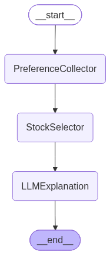

# Assignment 2 - Stage 2: Investment Assistant as a LangGraph Agent

The same interaction flow as Assignment 1, implemented as a simple LangGraph agent
with a strictly linear flow (no loops, no conditions):

`PreferenceCollector -> StockSelector -> LLMExplanation -> END`

The agent state (`AgentState`) is passed through the nodes. Stock selection is
rule-based; the explanations are written by an LLM (OpenAI `gpt-4o-mini`).



## Files

| File | Purpose |
|------|---------|
| `stage2_agent.py` | `AgentState`, the 3 nodes, `build_graph()` (also draws the diagram) and `main` |
| `run_tests.py` | Runs the 3 test scenarios and writes `tests_2.docx` |
| `tests_2.docx` | Test results: user-agent interaction for each scenario |
| `agents_plots/agent_s2.png` | Diagram of the agent |
| `utils.py` | Shared functions from Stage 1 (load profiles, ask preferences, filter stocks, LLM helpers) |
| `stage1.py` | The Stage 1 program (kept here because Stage 2 reuses its functions) |
| `config.py` | Settings (model, valid answers, counts, apology sentence) |
| `md_to_json.py` | Helper: converts `stocks_profiles.md` into `stocks_profiles.json` |
| `stocks_profiles.md` / `.json` | The predefined stock profiles |

## Run

```bash
pip install -r requirements.txt
python stage2_agent.py   # run the agent
python run_tests.py      # run the 3 scenarios and create tests_2.docx
```

The OpenAI key is read from a `.env` file (`OPENAI_API_KEY=...`) in this folder
or in the repository root.

## Note on stock selection

The user's risk tolerance is treated as a ceiling: a stock fits if its risk level is
at or below the requested one (exact matches first, at most 5 stocks). See the note
at the top of `tests_2.docx` for the reason.
